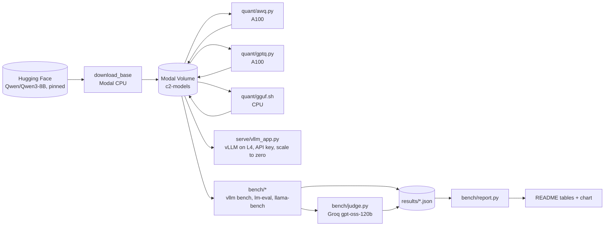

# reel-history-k8s

A personal project in two parts. **Part 1** quantizes Qwen3-8B to 4-bit weights three ways (AWQ and GPTQ with llm-compressor, GGUF Q4_K_M with llama.cpp), serves the GPU variants with vLLM on Modal, and measures what that buys: throughput, latency, weight and KV-cache memory, perplexity in English and French, explanation quality judged against the BF16 model, and cost per explanation. The headline numbers are at the top of the results below. **Part 2** (in progress) runs the Reel History recommender and a "why this film" explainer on Kubernetes.

Models on Hugging Face: [AWQ](https://huggingface.co/karthikcr/Qwen3-8B-W4A16-AWQ) · [GPTQ](https://huggingface.co/karthikcr/Qwen3-8B-W4A16-GPTQ) · [GGUF](https://huggingface.co/karthikcr/Qwen3-8B-GGUF)

## Architecture



Weights never leave Modal except for the push to Hugging Face. Every benchmark runs in a Modal container next to the model, writes a JSON record to `results/`, and `bench/report.py` turns those records into the tables below.

## Results
<!-- RESULTS:START -->
### Headline

- **AWQ W4A16** vs BF16: output throughput 2.79x at concurrency 1, 2.19x at concurrency 16; 9.56 GiB less weight memory.
- **GPTQ W4A16** vs BF16: output throughput 2.83x at concurrency 1, 2.22x at concurrency 16; 9.59 GiB less weight memory.

### Throughput and latency

`vllm bench serve` on one NVIDIA L4, random prompts of 512 tokens in and exactly 256 out.

| Variant | Concurrency | Output tok/s | Req/s | TTFT p50 ms | TTFT p95 ms | TPOT p50 ms | TPOT p95 ms |
|---|---|---|---|---|---|---|---|
| BF16 | 1 | 16.5 | 0.06 | 187.7 | 194.1 | 60.2 | 60.2 |
| BF16 | 4 | 60.7 | 0.24 | 258.2 | 736.5 | 64.3 | 66.1 |
| BF16 | 16 | 206.6 | 0.81 | 1,238.5 | 2,051.0 | 73.6 | 77.1 |
| AWQ W4A16 | 1 | 46.0 | 0.18 | 155.4 | 162.2 | 21.2 | 21.3 |
| AWQ W4A16 | 4 | 167.6 | 0.65 | 132.7 | 650.3 | 22.6 | 24.4 |
| AWQ W4A16 | 16 | 452.4 | 1.77 | 1,089.5 | 2,092.5 | 31.7 | 36.4 |
| GPTQ W4A16 | 1 | 46.5 | 0.18 | 153.2 | 164.0 | 21.0 | 21.0 |
| GPTQ W4A16 | 4 | 170.7 | 0.67 | 124.4 | 609.4 | 22.2 | 23.9 |
| GPTQ W4A16 | 16 | 459.1 | 1.79 | 939.1 | 1,935.0 | 31.8 | 35.4 |

### Memory

From vLLM's startup log, same `--gpu-memory-utilization` for every variant.

| Variant | Weights GiB | KV cache GiB | KV cache tokens | Max concurrent 4096-token requests |
|---|---|---|---|---|
| BF16 | 15.27 | 3.73 | 27,168 | 6.63 |
| AWQ W4A16 | 5.71 | 13.24 | 96,416 | 23.54 |
| GPTQ W4A16 | 5.68 | 13.26 | 96,560 | 23.57 |

### Quality

Word perplexity (lower is better) with lm-evaluation-harness. Judge: openai/gpt-oss-120b on groq, 50 MovieLens prompts, both answer orders; a win or loss needs agreement in both orders.

| Variant | WikiText-2 | French Wikipedia | Judge vs BF16 (win / tie / loss) |
|---|---|---|---|
| BF16 | 12.74 | 38.23 | reference |
| AWQ W4A16 | 13.09 | 39.31 | 12 / 19 / 19 |
| GPTQ W4A16 | 13.36 | 44.01 | n/a |

### Cost

Modal list price per second x measured seconds.

| Variant | Hardware | Concurrency | Seconds for 50 explanations | USD per 1,000 explanations |
|---|---|---|---|---|
| BF16 | L4 | 16 | 27.0 | 0.186 |
| AWQ W4A16 | L4 | 16 | 12.3 | 0.086 |
| GPTQ W4A16 | L4 | 16 | 10.9 | 0.076 |
| GGUF Q4_K_M | 8 CPU cores | 1 | 554.8 | 1.558 |

### CPU baseline

`llama-bench` (v0.7.0), 512 prompt tokens, 256 generated.

| Variant | CPU cores | Prompt tok/s | Generation tok/s |
|---|---|---|---|
| GGUF Q4_K_M | 8 | 77.2 | 18.5 |


<!-- RESULTS:END -->

## How it's evaluated

- **Speed and memory:** `vllm bench serve` against vLLM on localhost inside the same L4 container, with random fixed-length prompts and outputs, greedy decoding, at three concurrency levels. Weight memory and KV-cache capacity come from vLLM's startup log, with the same memory budget for every variant.
- **Perplexity:** lm-evaluation-harness (vLLM backend) on WikiText-2 and on a pinned slice of French Wikipedia (`bench/tasks/frwiki_ppl.yaml`).
- **Explanation quality:** prompts built from MovieLens ml-latest-small (`bench/build_prompts.py`, half English, half French). Each variant answers them; Groq `openai/gpt-oss-120b` compares every answer with the BF16 answer in both orders, and only verdicts that survive the swap count as a win or loss. The judge prompt is `bench/judge_prompt.txt`.
- **Cost:** Modal list price per second × measured seconds, from `quant/config.py`.
- **Rerun:** every number above comes from `results/`; `uv run python -m bench.report` rebuilds the tables and chart.

## Decisions and trade-offs

- Qwen3-8B over Mistral-7B and Qwen3.5-9B: dense standard attention, strong French, supported by both tools.
- One calibration set for AWQ and GPTQ, so the algorithm is the only variable.
- Benchmarks run next to the model on localhost, measuring the engine rather than the network.
- A judge from outside the Qwen family, run in both answer orders.

Full list with the rejected alternatives: [DECISIONS.md](DECISIONS.md).

## Limitations

- Everything runs on one GPU type (L4), one model and one request shape; ratios on an A100 or H100, or with long prompts, will differ.
- The 4-bit variants lose more in French than in English: both perplexity and the judge show a larger drop on French text, so the English numbers flatter them for a French audience.
- The judge is a single LLM. Requiring agreement across both answer orders removes position bias but not the judge's own taste, and many pairs end as ties.
- GGUF has no perplexity score, because llama.cpp's perplexity tool isn't comparable with lm-eval's; its quality comes from the judge only, and its CPU numbers come from one Modal CPU type.
- Speed tests use synthetic random prompts, not real explanation traffic; the explanation timing shows the real-traffic cost.

## Run it

Needs [uv](https://docs.astral.sh/uv/) and a logged-in Modal CLI (`modal token new`).

```bash
uv sync
uv run pytest

# Phase 1: quantize on Modal (weights land in the Modal Volume `c2-models`)
uv run modal run -m quant.awq --smoke     # quick end-to-end check
uv run modal run -m quant.awq
uv run modal run -m quant.gptq
uv run modal run -m quant.gguf
uv run modal run -m quant.verify          # every variant loads and generates

# Phase 2: serve a variant (bf16, awq or gptq) with vLLM on an L4, scaled to zero when idle.
# Needs a Modal secret with the API key the server checks:
modal secret create vllm-api-key VLLM_API_KEY=$(openssl rand -hex 32)
VARIANT=awq uv run modal run -m serve.smoke

# Phase 3: benchmark (each writes results/bench/<name>.json)
uv run modal run -m bench.serve_bench --variant awq
uv run modal run -m bench.ppl --variant awq
uv run modal run -m bench.explain --variant awq
uv run modal run --detach -m bench.judge::run_judge --variant awq   # needs a Modal secret `groq`
uv run modal run -m bench.gguf_bench
uv run python -m bench.report             # rebuild the tables and chart above
```

MovieLens data: F. Maxwell Harper and Joseph A. Konstan, *The MovieLens Datasets: History and Context*, ACM TiiS 2015; terms in `bench/data/MOVIELENS_NOTICE.txt`.
